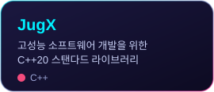
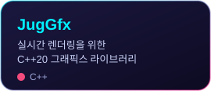
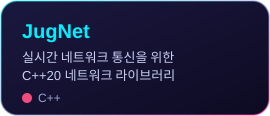
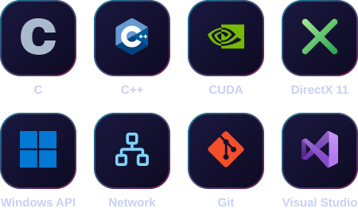
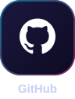

## 🧑‍💻 About Me
게임을 만들어 배포한 경험에서 출발해, C++로 엔진과 라이브러리, 개발 도구를 만들어 왔습니다. 새로운 기술은 직접 구현하며 익히고, 디버깅을 통해 원인을 분석하여 해결하며, 유지보수와 확장이 가능한 구조를 설계하는 것을 고민합니다. 팀 개발과 코딩 교육·운영을 경험하며, 서로의 상황을 공유하고 필요한 일을 함께 맡는 방식으로 일해 왔습니다.

### 🔨 할 수 있는 일
- C++ 기반 소프트웨어 개발
- 게임 콘텐츠, 엔진, 툴 개발
- 실시간 컴퓨터 그래픽스 및 GPGPU 프로그래밍
- 서버 및 네트워크 프로그래밍
- 디버거를 활용한 문제 해결 및 유지보수

 

## 📌 Pinned

 

## 🛠️ Skills & Tools

 

## 📮 Social & Contact

&nbsp;&nbsp;
&nbsp;&nbsp;
&nbsp;&nbsp;

