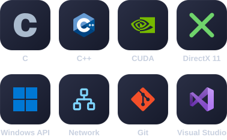

## 🧑‍💻 About Me
**궁금한 원리를 직접 구현하고, 실행 결과로 확인하는 C++ 개발자입니다.**  
C/C++ 기반으로 Windows 플랫폼에서 게임, 실시간 3D 그래픽스, 네트워크 기능을 개발합니다.  
C++20을 즐겨 사용하며, GPGPU 기술에도 관심이 많습니다.

### 🧭 일하는 방식
- 🔬 새로운 분야는 작게라도 직접 구현하며 원리를 이해합니다.
- 🔍 추측보다 실행 상태와 데이터를 근거로 원인을 좁혀 갑니다.
- 🧱 성능과 함께 쓰는 사람이 이해하기 쉬운 구조를 같이 고민합니다.
- 🤝 맡은 영역은 책임지고, 상황을 공유하며 필요한 일은 함께 맡습니다.

### 🔨 무엇을 할 수 있나요?
- 🧩 C/C++ 고성능 라이브러리 개발
- 🎮 DirectX 11 을 이용한 3D 컴퓨터 그래픽스 작업
- 🖥️ Windows 환경에서 다양한 소프트웨어 개발
- 🕹️ Windows 플랫폼 게임 개발
- 🌐 게임 플레이에 적합한 실시간 네트워크 기능 개발
- 🚀 GPGPU를 활용한 GPU 프로그래밍

 

## 🛠️ Skills & Tools

 

## 🌐 Social

 

## 📮 Contact

