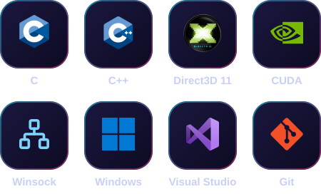
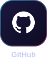
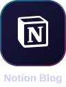

## 🧑‍💻 About Me
취미로 게임을 만들어 배포한 경험을 시작으로, C++로 게임 엔진과 그래픽스·네트워크 라이브러리, 개발 도구를 만들어 왔습니다. 새로운 기술은 직접 구현해 원리를 확인하고, 문제가 생기면 디버깅으로 원인을 찾으며, 개선한 결과는 측정으로 검증합니다. 동료가 쓰기 편한 구조와 도구를 고민하고, 최근에는 AI도 개발에 적극 활용하고 있습니다. 엔진 개발 팀과 코딩 교육 단체를 이끌며 다양한 사람들과 소통하고 협력해 문제를 해결하고 함께 결과를 만들어 왔습니다.

### 🔨 What I Can Do
- C++ 기반 소프트웨어 개발
- 게임 콘텐츠, 엔진, 툴 개발
- 실시간 컴퓨터 그래픽스 및 GPGPU 프로그래밍
- 서버 및 네트워크 프로그래밍
- 디버거를 활용한 문제 해결 및 유지보수
 

## 🛠️ Skills & Tools

 

## 📮 Social & Contact

&nbsp;&nbsp;
&nbsp;&nbsp;
&nbsp;&nbsp;
&nbsp;&nbsp;

